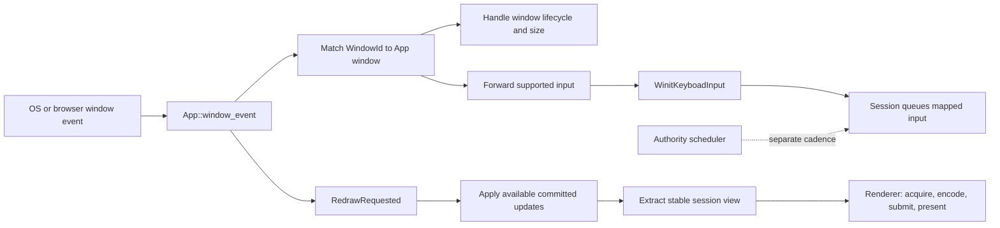

# Window Events

## Purpose and Status

This guide defines how `anzu-winit` should understand and route `winit::event::WindowEvent` in `App::window_event`. It is an implementation guide, not a claim that the handler is complete. The handler in `src/app.rs` matches the event variants, but most branches still contain `todo!()`. The `winit` dependency is version 0.30.13.

`ApplicationHandler::window_event` is called when the operating system sends an event to a `winit` window. It receives the active event loop, the event's `WindowId`, and one owned `WindowEvent`. The callback is a platform boundary. It should handle window lifecycle, forward supported input, and request or perform redraw work. It should not contain ROM rules or make redraw frequency the simulation clock.

## Event Path

The session and renderer stages in this diagram describe the target boundary. Current `SessionData` has an input adapter and server, but its update application is private and no display adapter is connected. `anzu-render-wgpu` is placeholder code. Therefore, the redraw path cannot yet call a real extraction or renderer API.

## Routing Rules

1. Match `window_id` against the window owned by `App`. Ignore an event for a window that the app does not own. This is required if the app later owns more than one window.
2. Handle app and window lifecycle events in the platform shell. For the current single-window app, `CloseRequested` should request event-loop exit. `Destroyed` should be treated as the end of that window's usable lifetime.
3. Forward only supported user input to the input adapter. The adapter converts supported host events to `InputSignal`; it does not decide ROM behavior.
4. Handle `Resized` and `ScaleFactorChanged` as renderer configuration inputs. Configure or mark the surface for reconfiguration using physical pixel dimensions. Do not configure a surface with a zero width or height.
5. Render in response to `RedrawRequested`. `Window::request_redraw` queues a redraw request. Winit can combine duplicate requests, and the callback is aligned with the host drawing cycle where supported.
6. Keep authority scheduling independent from redraw count. A redraw is a presentation opportunity, not a fixed simulation tick. `about_to_wait` is not the recommended place to render.
7. Keep unhandled events harmless. A wildcard branch is suitable when Anzu does not support an event; log only events that help diagnose a real issue.

The event is passed by value. If one callback branch needs to forward it, make the routing decision before moving it. Avoid cloning every event only to inspect it.

## Event Groups

The following list covers the 28 variants in `winit 0.30.13`. Platform support and event details can differ. Use the upstream variant documentation for platform-specific rules.

### Lifecycle and Window State

| Variant | Meaning | Anzu handling guidance |
|---|---|---|
| `CloseRequested` | The user or window system requested that the window close. | Request app exit or begin an explicit close flow. Do not treat this as `Destroyed`. |
| `Destroyed` | The window was destroyed. | Stop using its window and surface resources. Keep cleanup idempotent because lifecycle notifications can vary by platform. |
| `Focused(bool)` | The window gained or lost keyboard focus. | Track focus if input behavior needs it. On focus loss, clear any app-maintained held-key state so a missed release cannot leave an action active. |
| `Occluded(bool)` | The window is fully hidden from view. | Use as a possible rendering or resource hint only. This event is unsupported on some platforms and does not mean the app is suspended. |
| `RedrawRequested` | The host or app requested a redraw. | Apply available session updates, extract a stable view, then render when those systems exist. Do not advance one fixed tick per redraw. |
| `Resized(PhysicalSize)` | The client area changed size, in physical pixels. | Update renderer surface dimensions. Ignore or defer configuration while either dimension is zero. |
| `ScaleFactorChanged { scale_factor, inner_size_writer }` | The window's logical-to-physical scale changed. | Track the scale factor and use the provided writer only if Anzu needs to choose a different inner size. Reconcile renderer dimensions with the resulting physical size. |
| `Moved(PhysicalPosition)` | The window changed position. | Ignore unless window placement, monitor selection, or diagnostics need it. Not supported on Web, Wayland, iOS, or Android. |
| `ThemeChanged(Theme)` | The system window theme changed. | Update platform-shell UI theme if Anzu adds theme-aware UI. The event is not available on every platform. |
| `ActivationTokenDone { serial, token }` | A requested activation token became available. | Ignore unless the app requests and uses platform activation tokens. |

`Window::inner_size()` returns physical client-area dimensions. `Window::scale_factor()` maps logical and physical pixels, and can change when a window moves between displays or browser zoom changes. Do not treat logical dimensions as surface texture dimensions.

### Keyboard and Text Input

| Variant | Meaning | Anzu handling guidance |
|---|---|---|
| `KeyboardInput { event, is_synthetic, .. }` | A key press or release was received. | Send supported events to `WinitKeyboadInput`, which currently maps physical letter keys, arrows, Escape, Enter, Space, and Backspace to input signals. The adapter currently ignores `is_synthetic`; decide and test the desired focus-transition behavior before changing that policy. |
| `ModifiersChanged(Modifiers)` | Modifier-key state changed. | Track modifiers if control mapping needs Shift, Control, Alt, or Super. The current adapter does not use this event. |
| `Ime(Ime)` | An input method emitted text composition or committed text. | Use for text entry, not game-style physical controls. Winit requires IME to be enabled on the window. |

`KeyboardInput` is a physical key event in the current adapter: `PhysicalKey::Code(KeyCode::KeyA)` maps to the character-like internal key `a`, independent of the typed character. This is useful for positional controls, but it is not text input and does not account for keyboard layout. Use IME or logical text input for text entry.

Winit can synthesize key transitions when focus changes on some platforms. Synthetic releases can prevent stuck input. Do not discard synthetic events without an alternative focus-loss reset. The current input mapping returns `Pressed` or `Released`; higher layers still need clear handling for unsupported keys and focus transitions.

### Pointer, Touch, and Gestures

| Variant | Meaning | Anzu handling guidance |
|---|---|---|
| `CursorEntered { .. }` | The cursor entered the window. | Track pointer presence if a UI interaction needs it. |
| `CursorLeft { .. }` | The cursor left the window. | Clear any stored pointer position or hover state. |
| `CursorMoved { position, .. }` | The cursor moved in window-relative physical pixels. | Convert coordinates only at the UI or display boundary that needs them. On Web, CSS border, padding, and transforms are not included. Winit warns against using this event for non-cursor-like input such as raw camera motion. |
| `MouseInput { button, state, .. }` | A mouse button changed state. | Map supported buttons to semantic input. Preserve press and release transitions. |
| `MouseWheel { delta, phase, .. }` | The wheel or touchpad scrolled. | Handle line and pixel deltas as different units. Use phase when interaction needs gesture boundaries. |
| `Touch(Touch)` | A touch event occurred. | Add only when a touch interaction contract exists. Web coordinates also exclude CSS border, padding, and transforms; macOS does not support this variant. |
| `AxisMotion { axis, value, .. }` | An analog axis changed. | Normalize and map only known axes. Winit notes that this can duplicate more specific events. |
| `PinchGesture { delta, .. }` | A two-finger zoom gesture occurred. | Optional display/UI input. Supported on macOS and iOS; the delta can be NaN, so validate before use. |
| `PanGesture { delta, phase, .. }` | A multi-finger pan gesture occurred. | Optional display/UI input. Currently supported on iOS only. |
| `RotationGesture { delta, .. }` | A two-finger rotation gesture occurred. | Optional display/UI input. Supported on macOS and iOS. Positive delta means counterclockwise rotation. |
| `DoubleTapGesture { .. }` | A platform gesture similar to smart zoom occurred. | Optional display/UI input. Supported on recent macOS and iOS versions. Do not assume a specific physical gesture on every platform. |
| `TouchpadPressure { pressure, stage, .. }` | Touchpad pressure changed. | Ignore unless pressure is part of a defined input mapping. Current support is limited to Apple Force Touch devices. |

### File Drag and Drop

| Variant | Meaning | Anzu handling guidance |
|---|---|---|
| `HoveredFile(PathBuf)` | A file is being dragged over the window. | Use to show a drop target only if file import is supported. Multiple files can produce multiple events. |
| `HoveredFileCancelled` | A hovered file left the window. | Clear the pending drop-target state. One event can cancel a multi-file hover. |
| `DroppedFile(PathBuf)` | A file was dropped into the window. | Validate the path and file contents at the import boundary. Multiple dropped files produce separate events. |

File paths and drag-and-drop support vary by platform. The current browser app has no file-import contract, so these events should be ignored for now.

## Current Anzu Scope

The current `WinitKeyboadInput` implements `InputAdapter<Command = WindowEvent>`. It maps keyboard events to `InputSignal` and returns `None` for other event variants and unsupported keys. `SessionData::adapt_input` queues an input only when mapping returns `Some`.

This means the first useful `window_event` implementation can route keyboard input to the session and handle window lifecycle events. Resize and redraw branches must remain explicit integration points, not pretend calls to renderer methods that do not exist yet. The wgpu crate currently has no active renderer, and the session has no public update-application or extraction API.

## Redraw and Renderer Boundary

When renderer integration exists, the `RedrawRequested` branch should follow these responsibilities:

1. Apply complete committed update batches available to the session.
2. Read a stable view of session-permitted state through the display adapter.
3. Acquire the surface target.
4. Prepare changing GPU resources and encode commands.
5. Submit command buffers and present the frame.
6. Record extraction, acquire, upload, encoding, submission, present, and failure diagnostics as separate stages where instrumentation is available.

If surface acquisition fails, report or recover from the rendering failure without undoing committed simulation updates. A minimized or zero-sized window must not cause invalid surface configuration. Surface recovery policy belongs to the renderer/runtime integration contract.

## Implementation Checklist

- [ ] Ignore events whose `WindowId` does not match the owned window.
- [ ] Route supported keyboard events to the session input adapter.
- [ ] Define focus-loss behavior for held input and synthetic key transitions.
- [ ] Request exit for `CloseRequested`; keep it distinct from `Destroyed`.
- [ ] Handle physical resize and scale-factor changes without configuring a zero-sized surface.
- [ ] Draw only on `RedrawRequested` and keep authority ticks independent from redraw count.
- [ ] Keep unsupported, platform-specific events non-fatal.
- [ ] Add tests or manual checks for keyboard press/release, focus loss, close, resize, scale changes, and redraw requests when the corresponding runtime or renderer APIs exist.

## References

- [winit 0.30.13 `ApplicationHandler`](https://docs.rs/winit/0.30.13/winit/application/trait.ApplicationHandler.html)
- [winit 0.30.13 `WindowEvent`](https://docs.rs/winit/0.30.13/winit/event/enum.WindowEvent.html)
- [winit 0.30.13 `Window`](https://docs.rs/winit/0.30.13/winit/window/struct.Window.html)
- [Anzu architecture](../documents/architecture.md#platform-and-runtime-stages)
- [Runtime scheduling and browser lifecycle](../documents/runtime-integration-brainstorms.md#topic-6-scheduling-and-browser-lifecycle)
- [Runtime API contracts](../documents/api.md#current-source-interfaces)