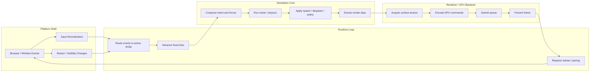
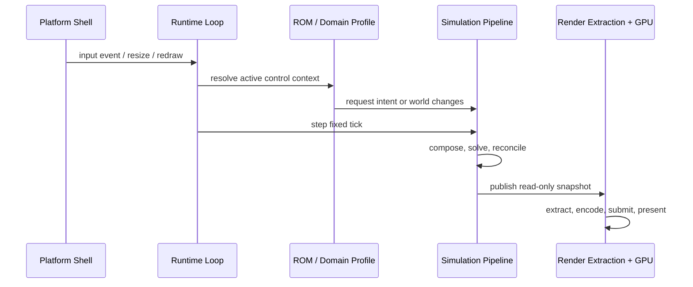
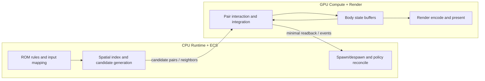

# Architecture

## System Overview
This document defines target architecture and records selected current implementation facts. The target contracts below are not all implemented. See [API Reference](api.md) for current source behavior.

The target runtime uses separate layers so the simulation and renderer can evolve independently.

Target layers:
- Platform shell: Host integration for the window, canvas, events, and lifecycle.
- Runtime loop: Owns frame ordering, fixed-tick orchestration, and lifecycle.
- Simulation pipeline: Composes intent, applies transforms, runs physics, and reconciles state in explicit stages.
- World state: Source of truth for simulation-owned state, transforms, and physics outcome.
- Render extraction: Converts simulation state into GPU-ready draw parameters.
- Renderer/GPU backend: Owns device resources and submits command buffers.

Target contracts:
- ROMs own input vocabulary and scenario rules.
- Normalize host-specific input before the runtime applies profile rules. Prefer semantic controls when the host can provide them.
- Simulation composes applied intent first, then mutates world state through the physics pipeline.
- Physics updates simulation-owned state, such as transforms, velocities, and contact outcomes.
- Rendering reads state snapshots and must not contain gameplay business rules.
- Resource creation/destruction is centralized in renderer-owned lifecycle code.

Current implementation note: the active texture demo handles `P` to change projection mode and `Escape` to exit. The previous gamepad, ROM-context, and overlay contracts remain in `anzu-engine/src/abandoned_generated_code/` and are not active engine behavior.

## Core Glossary

- Simulation and visualization system: The engine core. It is domain-neutral and not game-specific.
- Domain profile: A concrete application of the core system (games are one profile).
- Entity: Stable identity that links state across simulation, rendering, and tooling.
- State: Time-varying data owned by simulation systems.
- Physics mesh: Canonical local-space collision geometry used for collision and mass-property construction.
- Solver: Deterministic numerical stage that advances simulation state per tick.
- Runtime pipeline: Ordered stages executed each frame/tick (input, compose, simulate, reconcile, extract, render).
- Render extraction: Read-only translation from simulation state into GPU-ready draw data.
- Adapter: Boundary layer that maps platform/runtime specifics into core abstractions.
- Resource handle: Stable ID referencing GPU/asset resources without embedding ownership in gameplay objects.

Terminology policy:
- Prefer domain-neutral terms (`simulation`, `visualization`, `domain profile`) in architecture and APIs.
- Treat game-specific words as profile-level vocabulary, not engine-core vocabulary.

## Runtime Rewrite Direction

This section records the target design for the runtime rewrite. It does not describe a complete, implemented runtime API.

The runtime is divided into four ownership areas:

- Platform loop: The host schedules work and provides events, time, input, surface lifecycle, and shutdown signals.
- Runtime core: The simulation advances authoritative world state and publishes stable snapshots.
- Session logic: The session owns membership, player policy, local input queues, prediction, correction, and each player's visible world projection.
- Adapters: Platform, display, and transport adapters connect host-specific interfaces to the runtime contracts.

The platform loop does not own simulation rules, authoritative world state, session policy, or render-extraction decisions. The runtime core must not depend on a display. It should support headless and render-enabled hosts when the selected simulation backend permits them.

### World and Session Ownership

- `WorldState` is the complete authoritative simulation state. Only the simulation authority mutates it.
- `SessionState` tracks session membership, policy, local or remote connections, submitted control queues, and the session-visible world projection. It is not the full world.
- `PlayerView` is a read-only view of the world subset that a player may see. It may also carry local prediction state and queued input.
- An `Actor` represents a participant or simulated entity. It expresses intent through commands or action requests; it does not directly mutate authoritative state.

The authority can run in-process for local use or on a remote server. The session sends commands to the authority and reconciles its local view from authoritative updates. A browser client is a session and presentation layer, not a second authority.

### Platform and Runtime Stages

Organize runtime work around explicit stage boundaries:

1. The platform acquires host events and timing information.
2. Session logic collects and validates input.
3. The simulation applies commands and advances authoritative state.
4. Render extraction reads a stable world snapshot.
5. The selected output adapter presents or publishes the result.
6. Profiling and diagnostics report stage costs and outcomes.

The platform triggers stages but does not choose simulation rules. Session logic sits above the simulation and below the platform shell. It owns participant policy and views, not world truth. Simulation and rendering remain separate so the runtime can run without a display. Render extraction reads a stable snapshot and does not mutate simulation-owned state.

### Local and Remote Operation

Use the same domain command and update contracts in local and remote modes. In local mode, in-process channels connect the session and authority. In remote mode, transport adapters encode and decode the same domain messages. A WebSocket or other network transport is an adapter, not the authority or the simulation.

This boundary supports local single-player iteration, deterministic tests, headless CPU or GPU validation, and remote clients without changing the simulation contract. See the design-only protocol contract in [API Reference](api.md#target-session-and-authority-protocol).

### Target Simulation Flow

The following flow describes the target ROM-based runtime. The active engine does not implement this complete flow.

1. Input adapters produce generic input events at the platform edge.
2. Browser input normalization translates raw controls into semantic controls where possible while preserving raw escape hatches for specialized hardware.
3. Runtime syncs the active ROM context from `ControlPlaneState` into the active `SimulationModel` before gameplay event dispatch and before each fixed update.
4. ROM simulation resolves inputs against the active context and may emit context transition requests (`Push`, `Pop`, `Replace`) back to the runtime.
5. Runtime applies requested context transitions to `ControlPlaneState`, then mirrors the resolved active context back into the simulation.
6. ROM simulation converts those events into intent and per-body applied forces.
7. World state is synchronized once per tick before physics.
8. Physics runs broadphase candidate selection, then narrowphase collision and impulse response.
9. ROM reconciliation handles policy-driven spawn/despawn and scenario-specific rules (including fragment replacement).
10. Rendering reads the final world snapshot and never writes simulation-owned state.

## Target Rendering Pipeline
Frame flow:
1. Platform receives redraw event.
2. Runtime accumulates fixed steps and executes the simulation pipeline.
3. Renderer acquires surface texture and encodes commands from the final world snapshot.
4. Renderer binds pipeline resources and submits draw calls.
5. Surface presents frame.

## Outer Loop and Inner Loop

The target runtime uses two nested loops:

- Outer loop: platform and window events, ROM lifecycle, surface resize, input normalization, and redraw scheduling.
- Inner loop: deterministic simulation ticks that transform world state, emit gameplay effects, and produce renderable snapshots.

The key boundary is ownership. The platform shell can forward events, but it should not decide domain profile policy. The simulation can request changes to state, but it should not own the GPU surface. The renderer can own device resources and presentation, but it should read from simulation outputs instead of mutating simulation-owned state.

Practical reading order for the inner loop:

1. Input arrives at the platform edge.
2. The runtime maps that input into the active ROM context.
3. The simulation composes intent and per-body changes once per tick.
4. Physics and policy stages mutate simulation-owned world state.
5. Extraction converts the final snapshot into GPU-ready render data.
6. The renderer owns the surface, queue, and present path.

That flow matches the architecture contract: ROMs define scenario rules, simulation owns state mutation, render extraction stays read-only, and the renderer remains responsible for device-facing work.

Mutation rule of thumb:

- Simulation stages (`Compose`, `Sim`, `Reconcile`) are allowed to mutate simulation-owned state.
- Extraction and renderer stages are read-only over the published simulation snapshot.

## Proposed Hybrid CPU/GPU Simulation Contract

The target architecture can use a hybrid simulation design. In that design, the CPU and GPU each own the work they handle best.

Ownership boundary:

- ECS/runtime owns entity lifecycle, domain profile policy, ROM rules, and deterministic stage ordering.
- CPU broadphase may own spatial indexing and candidate generation when this reduces transfer volume.
- GPU compute owns dense numeric work over packed buffers (force accumulation, pair evaluation, integration, constraint iterations).
- Renderer consumes the stabilized simulation snapshot and does not mutate simulation-owned state.

Why ECS remains required even with GPU simulation:

- ECS is the source of truth for identity, spawn/despawn, scenario tags, and policy transitions.
- Gameplay systems are heterogeneous and branch-heavy; they are not all good GPU kernels.
- Engine tooling needs ECS-level inspection, replay, save/load, and diagnostics.
- Backend variability (WebGPU/WebGL fallback behavior) requires stable runtime contracts above compute details.

Recommended data model for large body counts:

- Keep immutable/shared geometry in GPU-resident shape buffers keyed by `shape_id`.
- Keep dynamic body state in GPU-resident SoA-style buffers keyed by `body_id`.
- Send adjacency as contiguous arrays (`pair_list` or offset-indexed neighbor ranges), not pointer-heavy graph structures.
- Avoid hash-table-style vertex storage for rigid-body geometry; prefer contiguous ranges for cache/coalescing behavior.

Proposed transfer policy for browser WebAssembly:

- Prefer GPU-resident simulation state across frames.
- Prefer small command/event uploads and sparse readback instead of full-state roundtrips.
- Treat per-frame full upload plus full readback as a last resort for large simulations.
- Make transfer bytes a first-class metric in profiling and regression checks.

Historical vertical-slice targets:
- ROM-owned entities with shared world physics.
- Spatial broadphase before SAT narrowphase collision checks.
- Material-driven render path with per-batch pipeline selection.
- One vertex buffer and one uniform bind group for transform data.
- Role-pair collision policy routing for solid-body vs hitbox outcomes.
- Bullet-triggered asteroid fragment replacement with independent child entities.
- Platformer locomotion slice with traction, crawl stance scaling, and grounded jump behavior.

Archived rendering/material state:
- Entity mesh instances carry `material_id` values.
- Render extraction emits draw batches with material ranges.
- Renderer resolves material definitions from a registry with deterministic fallback.
- Pipeline selection is blend-aware (`Opaque`, `Alpha`, `Additive`) per draw batch.
- Per-material uniforms are bound via dynamic offsets for parameterized shading.
- Current shading model is PBR-lite (directional diffuse/specular + emissive), not full Disney BRDF.

Proposed rendering rules:
- Keep per-frame dynamic data in uniform buffers.
- Reuse pipeline and buffer objects across frames.
- Handle surface resize/lost/suboptimal events without panic.

## Resource Lifecycle
Lifecycle ownership:
- Initialization stage creates long-lived resources (pipeline, static buffers, bind group layouts).
- Frame stage updates transient data only (uniform writes, command encoder, render pass).
- Resize stage reconfigures surface-dependent resources.
- Shutdown stage allows window/event loop teardown without leaking resources.

Guidelines:
- Avoid resource re-creation in the hot path unless invalidated.
- Keep buffer usage flags minimal and explicit.
- Keep GPU state and simulation state represented as separate structs.

### Physics Mesh Residency Model

Definition:
- Physics mesh means local-space collision geometry used for collision queries and mass-property construction.
- Physics mesh is not per-frame world-space transformed vertices.

Buffer ownership:
- Keep one shared GPU shape buffer containing canonical local-space physics meshes.
- Each shape entry has stable shape metadata (vertex range, vertex count, optional edge range, and precomputed local mass properties).
- Bodies do not own vertex arrays; bodies own references to shape entries via `shape_id`.

Instantiation rule:
- Creating a new model instance that uses an existing physics mesh should create a new body state entry only.
- New body state stores transform, motion, material parameters, and mass overrides, but reuses the shared shape entry.
- Do not duplicate shape vertices per body unless deforming/destructible geometry requires unique topology.

When to copy mesh data:
- Copy only when the geometry itself changes (fracture, morph, procedural remesh, runtime authoring).
- If only transform or velocity changes, never copy shape vertices.
- If density/mass changes without topology changes, keep the same shape entry and update body mass properties from the same geometric source.

Construction-time mass properties:
- Build local-area/volume and inertia terms from the canonical local mesh once per shape.
- Cache these per-shape terms as read-only inputs; derive per-body inverse mass/inverse inertia from body density/mass policy.
- For static bodies, inverse mass and inverse inertia are zero while shape geometry remains shared.

Practical result:
- One geometry source drives both collision and construction-time inertia.
- Many bodies can reference one shape entry with independent dynamic state.
- Upload bandwidth stays low because per-frame updates touch body-state buffers, not shape-vertex buffers.

Residency and classification rules:
- Every runtime asset is classified as `critical`, `scaled_optional`, `reused`, or `streaming`.
- Runtime tracks residency state per handle (`Queued`, `Loading`, `Resident`, `EvictionPending`, `Evicted`).
- Quality fallback is mandatory for streamable visuals (fallback LOD/placeholder must exist).
- Eviction policy is class-specific and pressure-aware, not one global strategy.

Budget model:
- Budget hierarchy: `global` -> `cpu_wasm` and `gpu` -> per-class pools.
- Budget signals are dynamic and may change during a session.
- Pressure responses are staged: lower optional quality first, then evict non-critical content.
- Frame-critical logic must continue running when optional content is constrained.

Streaming subsystem:
- World content is partitioned into zones/cells with explicit dependencies.
- Cell activation is visibility-led with neighbor prefetch and unload hysteresis.
- Upload/stream work uses priority queues and bounded per-frame upload budgets.
- Renderer consumes resident handles only; streaming system drives transitions asynchronously.

## Performance Considerations
Runtime performance policy:
- Frame pacing: maintain stable pacing and avoid large dt spikes driving simulation instability.
- Allocation strategy: no avoidable heap allocations in per-frame hot path; reuse scratch buffers for tick-stage composition.
- Upload strategy: write only changed uniform/state data per frame.
- Batching: prefer fewer render passes and predictable state changes.
- Physics strategy: use spatial broadphase to minimize collision candidate pairs before SAT narrowphase.
- Composition strategy: compose forces and transforms once per tick, then apply to world objects in minimal passes.

Profiling gates:
- Establish baseline metrics before adding complex systems (auth, networking, compute offload).
- Require per-phase measurements for sync, composition, broadphase, narrowphase, reconcile, and render boundaries.
- Require measured bottlenecks before introducing compute pipelines.
- Keep fallback paths for browser backend variability (WebGPU/WebGL).

Future extension seams:
- Asset loading should produce content specs that instantiate ROM-facing world entities and simulation state.
- Simulation should accept ROM-defined intent/physics metadata rather than hardcoded game-specific rules.
- Networking should operate through transport abstractions and snapshot policies.
- Security should enforce deny-by-default and per-request authorization checks in server-facing components.

## Asset Ingestion Path

Target path:
1. `data-loader` reads source assets (`.glb` or `.obj` + `.mtl` + textures).
2. `asset-provider` canonicalizes and registers runtime asset records.
3. Runtime modules request model data from `asset-provider` by stable handles.
4. Physics creates `BodyState` from registered physics mesh handles, not from raw file streams.

Format-specific responsibility split:
- `data-loader` owns source decoding and format details.
- `asset-provider` owns canonical runtime representation and handle stability.
- Physics owns solver-side construction from canonical physics mesh records.

Canonicalization contract:
- Source formats are transport; runtime types are canonical.
- Imported mesh data is split into:
	- display mesh data (render-facing topology and material bindings), and
	- physics mesh data (local-space collision geometry and construction-time mass properties).
- Node/object transforms are applied during import canonicalization so physics mesh records remain stable local-space inputs.
- Textures/material data are optional for physics registration and must not block physics mesh registration.

Registration contract:
- `asset-provider` registers and indexes:
	- `display mesh handle`
	- `physics mesh handle`
	- `material handle`
	- `texture handle`
- Handle reuse is required for duplicate geometry/material content.
- `BodyState` stores physics mesh identity (shape id / physics mesh handle), while body motion/force/mass overrides stay body-local.

Failure policy:
- If display material/texture loading fails but physics mesh canonicalization succeeds, physics registration may continue with typed warnings.
- If physics mesh canonicalization fails, `BodyState` construction from that asset is denied with typed errors.

## Algebraic Contract (Category-Theoretic)

Decision:
- Model runtime orchestration and scene streaming as composable morphisms over explicitly owned state objects.

Evidence summary:
- Runtime frame contract, ownership boundaries, and stage ordering are already explicit in this document.
- Streaming taxonomy, residency state, and budget telemetry are captured in backlog planning for Feature 9.3 and Feature 10.x in [BACKLOG.md](../BACKLOG.md).

Notation legend:
- $D$: streaming demand object.
- $B$: budget object.
- $R$: residency-state object.
- $Q$: queue-state object.
- $P$: plan object.
- $M$: metrics object.
- $\Omega$: Initiative 1 product-state object.
- $f_{x}$: stage morphism for stage $x$.
- $\circ$: composition operator (right-to-left function composition).
- $\times$: product type/object.
- $\to$: total function/morphism boundary.

### Part A: Current Algebraic Contract (Streaming + Runtime Planning Surface)

Status note:
- This section documents the current contract surface used for planning and implementation guidance.

Objects (state spaces):
- $D$: streaming demand (visible-now, near-field prefetch, optional).
- $B$: streaming budget vector per frame.
- $R$: residency index (`Queued`, `Loading`, `Resident`, `EvictionPending`, `Evicted`).
- $Q$: work queues by tier (`critical_stream`, `normal_decode`, `background_cleanup`).
- $P$: feasible streaming plan.
- $M$: per-frame telemetry/metrics.

Budget vector:
$$
B_t = (b_{fetch}, b_{decode}, b_{upload}, b_{activate}, b_{evict})
$$

Core morphisms:
- $\text{plan}: D \times B \times R \to P$
- $\text{enqueue}: P \times Q \to Q$
- $\text{execute}: Q \times R \to (R, M)$
- $\text{adapt}: M \times B \to B$

Composed frame-local streaming step:
$$
F_{stream} = adapt \circ execute \circ enqueue \circ plan
$$

Contract laws:
1. Budget safety: executed work must satisfy per-stage caps in $B_t$.
2. Priority law: `critical_stream` demand is admitted before `normal_decode` and `background_cleanup`.
3. Determinism law: identical $(D, B, R)$ inputs produce equivalent $P$ and queue ordering.
4. Monotone progress law: if capacity is available, `Queued` work eventually reaches `Resident` or typed failure.
5. Non-blocking simulation law: optional stream work must not block fixed timestep progression.

Typed error boundary:
- Streaming and manifest failures are represented as `Result`-style typed errors at load and activation boundaries.

### Part B: Expansion to Initiative 1 (Runtime and Frame Lifecycle)

Initiative 1 state decomposition can be treated as a product object:
$$
\Omega = S_{shell} \times S_{runtime} \times S_{sim} \times S_{extract} \times S_{backend} \times S_{resources} \times S_{frame}
$$

Frame category objects:
- $A$: frame acquire state.
- $U$: simulation update state (fixed + variable orchestration).
- $X$: render extraction snapshot state.
- $E$: command encoding state.
- $S$: queue submission state.
- $P$: present state.

Primary frame contract morphisms:
- $f_{acquire}: \Omega \to A$
- $f_{update}: A \to U$
- $f_{extract}: U \to X$
- $f_{encode}: X \to E$
- $f_{submit}: E \to S$
- $f_{present}: S \to P$

Composed runtime pipeline:
$$
f_{frame} = f_{present} \circ f_{submit} \circ f_{encode} \circ f_{extract} \circ f_{update} \circ f_{acquire}
$$

Initiative 1 refinement map:
1. Feature 1.1 introduces stable outer-loop orchestration and fixed timestep scheduling, making $f_{update}$ explicit.
2. Feature 1.2 adds validated background-color configuration as a control-plane value consumed by $f_{encode}$.
3. Feature 1.3 and Feature 1.4 define baseline geometry/texture render paths and tighten extraction-to-encode compatibility.
4. Feature 1.5 and Feature 1.5b extend $S_{sim}$ from single-body to body-collection transforms while preserving one frame contract.
5. Feature 1.6 moves acquire/reconfigure/present failures to typed error boundaries, refining $f_{acquire}$ and $f_{present}$.
6. Feature 1.7 enforces strict acquire -> encode -> submit -> present ordering as a first-class invariant.
7. Feature 1.8 through Feature 1.12 complete decomposition of $\Omega$ into shell/runtime/simulation/extraction/backend/resource ownership domains.

Initiative 1 invariants:
1. Ownership separation: each component of $\Omega$ has one primary mutation owner.
2. Read-only extraction: $f_{extract}$ reads stabilized simulation state and does not mutate simulation-owned state.
3. Resource lifecycle separation: long-lived resources remain in $S_{resources}$; per-frame transient data remains in $S_{frame}$.
4. Error totality at boundaries: acquire/resize/reconfigure paths return typed errors rather than panic paths.

Initiative 1 law-check matrix:

| Feature | Primary morphism/law focus | Required invariant checks | Acceptance evidence |
|---|---|---|---|
| 1.1 Initialize runtime in browser host with stable frame loop | $f_{update}$ scheduler seam + stable pacing law | bounded delta handling, fixed-step accumulation, max-step cap | `FrameScheduler::begin_frame` unit tests + wasm/native compile checks + browser smoke checks |
| 1.2 Clear frame to configurable background color | config morphism into $f_{encode}$ clear-value path | typed color validation, deterministic next-frame apply, ROM translation boundary | background-color validation tests + clear-pass behavior checks |
| 1.3 Render baseline triangle geometry | extraction-to-encode geometry law | indexed draw contract, CCW triangle invariants, shader/vertex layout compatibility | mesh-provider and pipeline tests + manual centered-triangle verification |
| 1.4 Apply texture to baseline geometry | textured render composition law | UV cardinality/index bounds, texture identifier resolution, shader binding compatibility | textured mesh validation tests + textured-frame smoke checks |
| 1.5 Animate baseline transform at fixed timestep | $S_{sim}$ single-body transform evolution | deterministic fixed-step transform closure application, projection application correctness | runtime transform tests + projection toggle behavior checks |
| 1.5b Add N-body animation support for multiple bodies | $S_{sim}$ collection extension law | body-count parity across runtime transforms, uniform slots, and draw iteration | multi-body runtime tests + per-body draw-loop checks |
| 1.6 Handle surface resize, reconfigure, and present lifecycle safely | typed boundary refinement of $f_{acquire}$ and $f_{present}$ | no panic-path surface lifecycle handling, recoverable fallback behavior | error-path tests for acquire/reconfigure/present + runtime no-panic checks |
| 1.7 Maintain explicit frame contract acquire -> encode -> submit -> present | strict frame morphism ordering law | acquire -> encode -> submit -> present ordering remains explicit and traceable | ordering assertions + stage telemetry traces |
| 1.8 Split app shell state from runtime orchestration state | $\Omega$ ownership partition law (shell/runtime) | platform shell owns events/bootstrap; runtime owns pacing/orchestration | ownership-boundary review + boundary tests |
| 1.9 Split simulation-owned state from render backend state | $\Omega$ ownership partition law (simulation/backend) | simulation-owned state mutation isolated from backend lifecycle and surface state | mutation-scope tests + state-ownership review |
| 1.10 Add explicit render extraction state between simulation and renderer | explicit extraction object law | renderer input depends on extraction packet, not direct simulation schema coupling | extraction contract tests + coupling checks |
| 1.11 Keep long-lived render resources separate from per-frame transient state | resource lifecycle separation law | persistent resources isolated from transient frame objects | lifecycle tests + allocation/resource churn telemetry |
| 1.12 Migrate lib.rs to platform-shell ownership only (no gameplay mutation ownership) | terminal platform shell migration law | app shell constrained to platform shell concerns; simulation-owned state mutation moved out of shell | integration tests + ownership review checklist |

Verification policy:
1. Every feature acceptance proof should cite at least one invariant check from this matrix.
2. Any invariant regression blocks feature completion until the law is restored or contract is revised.

Rust mapping guidance:
1. Treat each object in $\Omega$ as a dedicated struct domain with explicit ownership.
2. Treat morphisms as functions/methods with `Result`-based typed error boundaries.
3. Treat frame invariants as testable laws (ordering, ownership, and non-blocking simulation behavior).
4. Keep function composition explicit in runtime orchestration so feature-by-feature refinements remain traceable.
