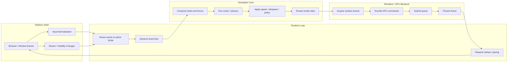
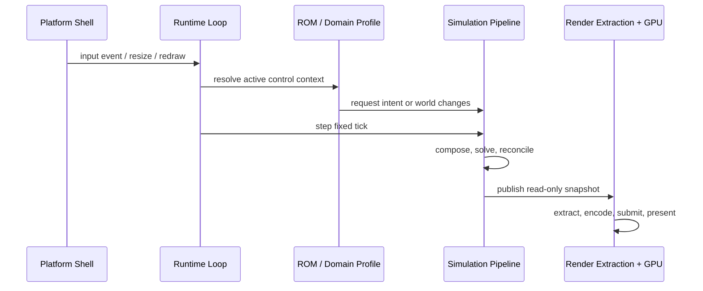
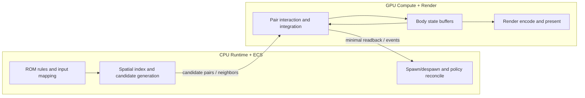

# Architecture

## System Overview
This document defines target architecture and records selected current implementation facts. The target contracts below are not all implemented. See [API Reference](api.md) for current source behavior.

The target runtime uses separate layers so the simulation and renderer can evolve independently.

Target layers:
- Platform shell: Host integration for the window, canvas, events, and lifecycle.
- Runtime loop: Owns frame ordering, fixed-tick orchestration, and lifecycle.
- Compute pipeline: Calculates proposed updates from commands, simulation time, and stable authoritative state.
- World state database: Owns authoritative state, applies updates, and publishes committed events.
- Session: Owns permitted actor-partitioned state, input adapter, and display adapter.
- Render extraction: The session-owned display adapter converts a stable view of the session's permitted state into backend-independent render data. Actor scope controls which data enters session state; it does not limit a display to one actor.
- Renderer/GPU backend: Owns device resources and submits command buffers.

Target contracts:
- ROMs own input vocabulary and scenario rules.
- Normalize host-specific input before the runtime applies profile rules. Prefer semantic controls when the host can provide them.
- Computation changes working data and proposes updates, but does not directly mutate committed world state.
- The authoritative state owner applies updates before publishing events to sessions.
- Rendering consumes extracted session data and must not contain simulation rules or unrestricted world access.
- Resource creation/destruction is centralized in renderer-owned lifecycle code.

Current implementation scope: use `anzu-runtime`, `anzu-winit`, `anzu-render-wgpu`, and rom packages for the next integration stage. Code under `anzu-engine` is excluded from this design pass and is not completion evidence.

Platform decision: `anzu-winit` is the browser frontend and its shipped runtime is browser-only. It can retain native `target_arch` paths for development-workspace builds and runs. Those paths do not make it the desktop frontend. A future `anzu-desktop` package will provide the desktop platform shell.

## Core Glossary

- Simulation and visualization system: The engine core. It is domain-neutral and not game-specific.
- Domain profile: A concrete application of the core system (games are one profile).
- Entity: Stable identity that links state across simulation, rendering, and tooling.
- State: Time-varying data owned by simulation systems.
- Physics mesh: Canonical local-space collision geometry used for collision and mass-property construction.
- Solver: Deterministic numerical stage that advances simulation state per tick.
- Runtime pipeline: Ordered stages executed each frame/tick (input, compose, simulate, reconcile, extract, render).
- Render extraction: Read-only translation from a stable view of session-permitted state into backend-independent render data.
- Adapter: Boundary layer that maps platform/runtime specifics into core abstractions.
- Resource handle: Stable ID referencing GPU/asset resources without embedding ownership in gameplay objects.

### Data-Oriented Design Vocabulary

These working definitions describe how Anzu organizes and transforms data. They are informed by Richard Fabian's [Data-Oriented Design](https://www.dataorienteddesign.com/dodbook/dodmain.html), but are written for this project and are not quotations. Extend this vocabulary as the design develops.

- Data table: A collection of records with a shared layout, stored to support the operations that use them.
- Row: The values at one table position. In a column-based layout, matching row positions across columns describe one record.
- Column: One field stored across multiple records, such as every boat's position.
- Component: A focused set of data associated with an entity or simulation role. Components can be stored and processed by type instead of inside one large entity object.
- Entity ID: A stable key used to associate records from different tables. The ID identifies the logical entity; it does not need to be its storage position.
- Secondary index: A derived lookup structure, such as `BoatId` to row position, that provides access to table data without owning a second copy of that data.
- Array of structures (AoS): A collection of complete records, such as `Vec<BoatRecord>`, where each record stores several fields together.
- Structure of arrays (SoA): Separate collections for fields, such as position and velocity arrays, where matching positions identify fields for the same record.
- Data transform: An operation that reads selected input data and produces updated or derived data. This term is distinct from an entity's spatial transform, which describes position, orientation, and scale.

Terminology policy:
- Prefer domain-neutral terms (`simulation`, `visualization`, `domain profile`) in architecture and APIs.
- Treat game-specific words as profile-level vocabulary, not engine-core vocabulary.

## Runtime Rewrite Direction

The 2026-10-16 brainstorm is the latest target design. This section takes precedence over older direct-mutation, direct-world rendering, and prediction-first recommendations. It does not describe a complete implementation.

The publish/subscribe and microservice comparisons describe logical boundaries, not separate deployments or a requirement for a message broker.

| Owner | Responsibility |
|---|---|
| `App` | Platform lifecycle, window/canvas, events, redraw requests, and ownership of the renderer |
| `Session` | Input adapter, display adapter, server connection, and permitted actor-partitioned session state |
| Compute engine | Propose updates from commands, fixed simulation time, and a stable authoritative state view |
| World state database | Own authoritative state, validate and apply proposed updates, then publish committed events |
| `LocalServer` | Coordinate the local authority and in-memory command/update delivery |
| `RemoteServer` | Client-side transport and queues using command/update types, without a simulation instance |
| Host package | Run the authority, accept remote connections, and enforce session and actor permissions |
| wgpu renderer | Own surface, device, queue, GPU resources, encoding, submission, and presentation |

The database is a logical state owner. No database product, durable storage, or separate process is selected. The runtime must support headless operation. A session-owned display adapter is a trait for extraction only, not GPU presentation.

### World and Session Ownership

- `WorldState` is authoritative. Only its state-application boundary commits changes.
- `SessionState` is persistent permitted state, owned and updated by the session. Its storage representation is separate from `WorldState`.
- A snapshot captures permitted state at a known revision for initialization or recovery. It is not the name for all mutable session storage.
- Actor scope controls which actor-specific state the authority publishes into a session. Session queries must exclude actor partitions that the session is not permitted to access.
- Display extraction reads the session's permitted state and may compose data for multiple actors into one shared display output, including separate views such as split screen. It does not impose an actor-per-display rule.
- A deployment may bind separate sessions and renderer surfaces to separate physical displays. For example, two local sessions may each contain one actor and present to one monitor. This is a topology choice, not a definition of actor scope.
- Commands express intent. Updates express computed state changes. Applying an update must not repeat expensive simulation decisions.

The same compatible update instructions should advance authoritative and session state. Filtering or reduced state may require a defined projection rather than identical raw updates. Initial state, ordering, and application semantics must match for reconstruction to succeed. Actor authorization is applied when data enters session state; display composition then operates on that permitted state. Prediction and interpolation are optional later presentation features, not baseline requirements.

### Compute, Commit, and Publish

```mermaid
flowchart LR
	Command[Commands and fixed tick] --> Compute[Compute against stable state]
	Compute --> Queue[1:1 ordered proposed-update queue]
	Queue --> Store[World state database: validate and commit]
	Store --> Filter[Session and actor authorization filtering]
	Filter --> Channels[1:n session-specific delivery channels]
	Channels --> State[Session applies actor-partitioned updates]
	State --> Display[Session-owned display adapter]
	Display --> Renderer[Backend-independent render data to renderer]
```

The compute engine publishes proposals to one authoritative consumer. Only committed events reach sessions. A queued command is not a committed command. Alternative CPU/GPU compute implementations share a contract, but identical numerical results require explicit rules and verification.

The compute state-read contract remains open. Define a stable revision and a stale-result policy before allowing concurrent proposals. Commit and publication must not leave sessions silently missing accepted changes. Durable recovery is required only if persistence becomes a requirement.

### Session and Actor Partitions

- Hard partition: `session_id` identifies a distinct delivery channel, analogous to a Kafka topic or a separate WebSocket connection.
- Soft partition: `actor_id` is a partition key within that session's messages and stored state.
- A session can contain several authorized actor partitions. Actor-specific consumers use scoped queries, not unrestricted storage access.
- Authorization selects permitted data before session delivery. Snapshots and incremental updates use the same disclosure rules.
- Physical and logical partitioning work with authentication, authorization, TLS, and other defense-in-depth controls. Partition labels do not replace those controls.

Preserve both scopes through routing, decoding, state application, queries, and extraction. Shared actor data, permission revocation, and subscription transitions still need explicit contracts. Data already disclosed cannot be made secret by removing a local copy.

### Platform and Runtime Stages

Organize runtime work around explicit stage boundaries:

The list below describes data dependencies, not one mandatory loop or a shared frequency. Input capture/polling, command delivery, computation, update application, extraction, drawing, audio, assets, and diagnostics can have different and dynamically changing cadences. Each needs explicit deadlines, work budgets, ordering, and overload/loss policies. See [the scheduling brainstorm](runtime-integration-brainstorms.md#topic-6-scheduling-and-browser-lifecycle).

1. The platform acquires host events and timing information.
2. Session logic collects and validates input.
3. The authority computes updates, commits them, and publishes permitted batches.
4. Session logic dequeues committed batches and updates its actor-partitioned state.
5. The display adapter reads a stable view of session-permitted state and extracts render data. It may include multiple actors and presentation views.
6. The renderer performs frame acquire, resource preparation, command encoding, queue submission, and present.
7. Profiling separates compute, commit, delivery, session application, extraction, upload, and rendering costs.

Authority progression must not mean one step per redraw. A local app may service an elapsed-time fixed-step scheduler and rendering from the same callback; no separate thread is required. Remote clients do not drive authority time. Scheduler ownership, catch-up limits, and local pause/resume policy remain undecided. A surface failure does not undo committed work. No lock or mutable state borrow should span asynchronous transport or GPU initialization. The renderer owns encoders and command buffers through submission; session state does not own them.

Cross-host goal: precise, tunable execution with measured error bars, not perfect or identical timing. Separate requested cadence from achieved cadence and measure lateness, queue age, and missed deadlines. Preserve delivery semantics while adapting scheduling facilities to each host. Frequency does not determine loss tolerance; skipping an obsolete display view does not permit dropping required committed updates. Rates, execution placement, and a general scheduler design are not yet selected.

### Local and Remote Operation

Use the same domain command and update contracts in local and remote modes. In local mode, in-process channels connect the session and authority. In remote mode, transport adapters encode and decode the same domain messages. A WebSocket or other network transport is an adapter, not the authority or the simulation.

`SimulationIO` supplies command/update associated types independently of state storage. It currently exists but is not wired into `Simulation`, `Server`, or `Session`. A remote client must not require a simulation implementation merely to name these types.

The proposed common connection contract queues commands and provides nonblocking `dequeue_update()` for complete committed batches. Empty queues, closed connections, and failures must be distinguishable. A connection trait with associated IO is recommended.

Decision, 2026-10-17: the platform host hardcodes the concrete local or remote connection. Session uses that concrete type through a generic connection contract. No runtime local/remote switching or `Server` enum is required. This resolves the earlier enum-selection question; exact trait signatures remain open.

A new host package is planned, with a transport-neutral name still to be selected. WebSocket over TLS is the proposed first transport. WebTransport remains an alternative if independent streams or datagrams justify it. Required incremental updates need reliable ordered delivery or explicit application recovery. Bound queues and define recovery for slow consumers.

See [API Reference](api.md#target-session-and-authority-protocol), [Transport Recommendations](websockets-recommendations.md), and [the backlog](../BACKLOG.md#current-priority-session-and-authority-integration).

### Next-Stage Decisions and Acceptance

Resolve command mapping from `InputSignal`, stable compute reads, update operations versus final values, filtered projections, snapshot handoff, scheduler ownership, shared actor data, and display composition/view selection. Do not treat proposed trait signatures or transport choices as approved implementation details.

Use [Future Brainstorms](runtime-integration-brainstorms.md) for topic context, questions, source entry points, and expected decisions. Prediction is low-priority future consideration, after the committed-update baseline and remote recovery are validated. Do not add prediction, rollback, or replay requirements to the current stage.

Acceptance requires local/remote reconstruction parity, commit-before-publish ordering, snapshot/update continuity, duplicate and gap handling, bounded queues, session isolation, actor-scoped exclusion, unsupported-input handling, redraw-independent ticks, and browser initialization/resize/recovery checks. Record low-cost work counters early and measure detailed stage timings separately.

### Target Simulation Flow

The following domain-stage sketch predates the current compute/commit split. Context routing and physics stages remain possible internal computation stages, not permission to mutate authoritative state directly.

1. Input adapters produce generic input events at the platform edge.
2. Browser input normalization translates raw controls into semantic controls where possible while preserving raw escape hatches for specialized hardware.
3. Runtime syncs the active ROM context from `ControlPlaneState` into the active `SimulationModel` before gameplay event dispatch and before each fixed update.
4. ROM simulation resolves inputs against the active context and may emit context transition requests (`Push`, `Pop`, `Replace`) back to the runtime.
5. Runtime applies requested context transitions to `ControlPlaneState`, then mirrors the resolved active context back into the simulation.
6. ROM simulation converts those events into intent and per-body applied forces.
7. World state is synchronized once per tick before physics.
8. Physics runs broadphase candidate selection, then narrowphase collision and impulse response.
9. ROM reconciliation computes policy-driven spawn/despawn and scenario-specific updates (including fragment replacement).
10. The state owner commits the resulting batch and publishes permitted updates. Display extraction reads updated session-permitted state, which may contain data for multiple actors.

## Target Rendering Pipeline
Frame flow:
1. Platform receives redraw event.
2. If this callback also services a local authority scheduler, determine due fixed steps from elapsed time, not redraw count. Remote authority runs on its host. Local suspension/catch-up policy remains open.
3. The session applies available committed batches and extracts render data through its display adapter.
4. Renderer acquires the surface texture, updates changing resources, and encodes commands from extracted data.
5. Renderer submits command buffers and presents the surface frame.
6. Diagnostics record stage costs, queue depth, transfer bytes, and backend failures.

Keep static resources resident where appropriate and use resource handles in extracted data. Define missing-resource fallback. WebGPU/WebGL capabilities and compute backends must not be assumed identical.

## Outer Loop and Inner Loop

Historical detail: the diagrams and mutation rules in this section describe an older direct-world pipeline. They are retained for context, not as the next-stage integration contract. The [Runtime Rewrite Direction](#runtime-rewrite-direction) supersedes their direct mutation and simulation-to-renderer paths.

The target runtime uses two nested loops:

- Outer loop: platform and window events, ROM lifecycle, surface resize, input normalization, and redraw scheduling.
- Inner loop: deterministic simulation ticks that transform world state, emit gameplay effects, and produce renderable snapshots.

The key boundary is ownership. The platform shell can forward events, but it should not decide domain profile policy. The simulation can request changes to state, but it should not own the GPU surface. The renderer can own device resources and presentation, but it should read from simulation outputs instead of mutating simulation-owned state.

Practical reading order for the inner loop:

1. Input arrives at the platform edge.
2. The runtime maps that input into the active ROM context.
3. The simulation composes intent and per-body changes once per tick.
4. Physics and policy stages mutate simulation-owned world state.
5. Extraction converts the final snapshot into GPU-ready render data.
6. The renderer owns the surface, queue, and present path.

That flow matches the architecture contract: ROMs define scenario rules, simulation owns state mutation, render extraction stays read-only, and the renderer remains responsible for device-facing work.

Mutation rule of thumb:

- Simulation stages (`Compose`, `Sim`, `Reconcile`) are allowed to mutate simulation-owned state.
- Extraction and renderer stages are read-only over the published simulation snapshot.

## Proposed Hybrid CPU/GPU Simulation Contract

Deferred research: this section predates session-filtered publication. Direct rendering from authoritative GPU body buffers must not bypass commit, permission filtering, session state, or display extraction. Residency is an optimization hypothesis, not an exception to these boundaries. GPU-resident authority and filtered session delivery need a measured transfer/readback design before implementation.

The target architecture can use a hybrid simulation design. In that design, the CPU and GPU each own the work they handle best.

Ownership boundary:

- ECS/runtime owns entity lifecycle, domain profile policy, ROM rules, and deterministic stage ordering.
- CPU broadphase may own spatial indexing and candidate generation when this reduces transfer volume.
- GPU compute owns dense numeric work over packed buffers (force accumulation, pair evaluation, integration, constraint iterations).
- Renderer consumes the stabilized simulation snapshot and does not mutate simulation-owned state.

Why ECS remains required even with GPU simulation:

- ECS is the source of truth for identity, spawn/despawn, scenario tags, and policy transitions.
- Gameplay systems are heterogeneous and branch-heavy; they are not all good GPU kernels.
- Engine tooling needs ECS-level inspection, replay, save/load, and diagnostics.
- Backend variability (WebGPU/WebGL fallback behavior) requires stable runtime contracts above compute details.

Recommended data model for large body counts:

- Keep immutable/shared geometry in GPU-resident shape buffers keyed by `shape_id`.
- Keep dynamic body state in GPU-resident SoA-style buffers keyed by `body_id`.
- Send adjacency as contiguous arrays (`pair_list` or offset-indexed neighbor ranges), not pointer-heavy graph structures.
- Avoid hash-table-style vertex storage for rigid-body geometry; prefer contiguous ranges for cache/coalescing behavior.

Proposed transfer policy for browser WebAssembly:

- Prefer GPU-resident simulation state across frames.
- Prefer small command/event uploads and sparse readback instead of full-state roundtrips.
- Treat per-frame full upload plus full readback as a last resort for large simulations.
- Make transfer bytes a first-class metric in profiling and regression checks.

Historical vertical-slice targets:
- ROM-owned entities with shared world physics.
- Spatial broadphase before SAT narrowphase collision checks.
- Material-driven render path with per-batch pipeline selection.
- One vertex buffer and one uniform bind group for transform data.
- Role-pair collision policy routing for solid-body vs hitbox outcomes.
- Bullet-triggered asteroid fragment replacement with independent child entities.
- Platformer locomotion slice with traction, crawl stance scaling, and grounded jump behavior.

Archived rendering/material state:
- Entity mesh instances carry `material_id` values.
- Render extraction emits draw batches with material ranges.
- Renderer resolves material definitions from a registry with deterministic fallback.
- Pipeline selection is blend-aware (`Opaque`, `Alpha`, `Additive`) per draw batch.
- Per-material uniforms are bound via dynamic offsets for parameterized shading.
- Current shading model is PBR-lite (directional diffuse/specular + emissive), not full Disney BRDF.

Proposed rendering rules:
- Keep per-frame dynamic data in uniform buffers.
- Reuse pipeline and buffer objects across frames.
- Handle surface resize/lost/suboptimal events without panic.

## Resource Lifecycle
Lifecycle ownership:
- Initialization stage creates long-lived resources (pipeline, static buffers, bind group layouts).
- Frame stage updates transient data only (uniform writes, command encoder, render pass).
- Resize stage reconfigures surface-dependent resources.
- Shutdown stage allows window/event loop teardown without leaking resources.

Guidelines:
- Avoid resource re-creation in the hot path unless invalidated.
- Keep buffer usage flags minimal and explicit.
- Keep GPU state and simulation state represented as separate structs.

### Physics Mesh Residency Model

Definition:
- Physics mesh means local-space collision geometry used for collision queries and mass-property construction.
- Physics mesh is not per-frame world-space transformed vertices.

Buffer ownership:
- Keep one shared GPU shape buffer containing canonical local-space physics meshes.
- Each shape entry has stable shape metadata (vertex range, vertex count, optional edge range, and precomputed local mass properties).
- Bodies do not own vertex arrays; bodies own references to shape entries via `shape_id`.

Instantiation rule:
- Creating a new model instance that uses an existing physics mesh should create a new body state entry only.
- New body state stores transform, motion, material parameters, and mass overrides, but reuses the shared shape entry.
- Do not duplicate shape vertices per body unless deforming/destructible geometry requires unique topology.

When to copy mesh data:
- Copy only when the geometry itself changes (fracture, morph, procedural remesh, runtime authoring).
- If only transform or velocity changes, never copy shape vertices.
- If density/mass changes without topology changes, keep the same shape entry and update body mass properties from the same geometric source.

Construction-time mass properties:
- Build local-area/volume and inertia terms from the canonical local mesh once per shape.
- Cache these per-shape terms as read-only inputs; derive per-body inverse mass/inverse inertia from body density/mass policy.
- For static bodies, inverse mass and inverse inertia are zero while shape geometry remains shared.

Practical result:
- One geometry source drives both collision and construction-time inertia.
- Many bodies can reference one shape entry with independent dynamic state.
- Upload bandwidth stays low because per-frame updates touch body-state buffers, not shape-vertex buffers.

Residency and classification rules:
- Every runtime asset is classified as `critical`, `scaled_optional`, `reused`, or `streaming`.
- Runtime tracks residency state per handle (`Queued`, `Loading`, `Resident`, `EvictionPending`, `Evicted`).
- Quality fallback is mandatory for streamable visuals (fallback LOD/placeholder must exist).
- Eviction policy is class-specific and pressure-aware, not one global strategy.

Budget model:
- Budget hierarchy: `global` -> `cpu_wasm` and `gpu` -> per-class pools.
- Budget signals are dynamic and may change during a session.
- Pressure responses are staged: lower optional quality first, then evict non-critical content.
- Frame-critical logic must continue running when optional content is constrained.

Streaming subsystem:
- World content is partitioned into zones/cells with explicit dependencies.
- Cell activation is visibility-led with neighbor prefetch and unload hysteresis.
- Upload/stream work uses priority queues and bounded per-frame upload budgets.
- Renderer consumes resident handles only; streaming system drives transitions asynchronously.

## Performance Considerations
Runtime performance policy:
- Frame pacing: maintain stable pacing and avoid large dt spikes driving simulation instability.
- Allocation strategy: no avoidable heap allocations in per-frame hot path; reuse scratch buffers for tick-stage composition.
- Upload strategy: write only changed uniform/state data per frame.
- Batching: prefer fewer render passes and predictable state changes.
- Physics strategy: use spatial broadphase to minimize collision candidate pairs before SAT narrowphase.
- Composition strategy: compose forces and transforms once per tick, then apply to world objects in minimal passes.

Profiling gates:
- Establish baseline metrics before adding complex systems (auth, networking, compute offload).
- Require per-phase measurements for sync, composition, broadphase, narrowphase, reconcile, and render boundaries.
- Require measured bottlenecks before introducing compute pipelines.
- Keep fallback paths for browser backend variability (WebGPU/WebGL).

Future extension seams:
- Asset loading should produce content specs that instantiate ROM-facing world entities and simulation state.
- Simulation should accept ROM-defined intent/physics metadata rather than hardcoded game-specific rules.
- Networking should operate through transport abstractions and snapshot policies.
- Security should enforce deny-by-default and per-request authorization checks in server-facing components.

## Asset Ingestion Path

Target path:
1. `data-loader` reads source assets (`.glb` or `.obj` + `.mtl` + textures).
2. `asset-provider` canonicalizes and registers runtime asset records.
3. Runtime modules request model data from `asset-provider` by stable handles.
4. Physics creates `BodyState` from registered physics mesh handles, not from raw file streams.

Format-specific responsibility split:
- `data-loader` owns source decoding and format details.
- `asset-provider` owns canonical runtime representation and handle stability.
- Physics owns solver-side construction from canonical physics mesh records.

Canonicalization contract:
- Source formats are transport; runtime types are canonical.
- Imported mesh data is split into:
	- display mesh data (render-facing topology and material bindings), and
	- physics mesh data (local-space collision geometry and construction-time mass properties).
- Node/object transforms are applied during import canonicalization so physics mesh records remain stable local-space inputs.
- Textures/material data are optional for physics registration and must not block physics mesh registration.

Registration contract:
- `asset-provider` registers and indexes:
	- `display mesh handle`
	- `physics mesh handle`
	- `material handle`
	- `texture handle`
- Handle reuse is required for duplicate geometry/material content.
- `BodyState` stores physics mesh identity (shape id / physics mesh handle), while body motion/force/mass overrides stay body-local.

Failure policy:
- If display material/texture loading fails but physics mesh canonicalization succeeds, physics registration may continue with typed warnings.
- If physics mesh canonicalization fails, `BodyState` construction from that asset is denied with typed errors.

## Algebraic Contract (Category-Theoretic)

Decision:
- Model runtime orchestration and scene streaming as composable morphisms over explicitly owned state objects.

Evidence summary:
- Runtime frame contract, ownership boundaries, and stage ordering are already explicit in this document.
- Streaming taxonomy, residency state, and budget telemetry are captured in backlog planning for Feature 9.3 and Feature 10.x in [BACKLOG.md](../BACKLOG.md).

Notation legend:
- $D$: streaming demand object.
- $B$: budget object.
- $R$: residency-state object.
- $Q$: queue-state object.
- $P$: plan object.
- $M$: metrics object.
- $\Omega$: Initiative 1 product-state object.
- $f_{x}$: stage morphism for stage $x$.
- $\circ$: composition operator (right-to-left function composition).
- $\times$: product type/object.
- $\to$: total function/morphism boundary.

### Part A: Current Algebraic Contract (Streaming + Runtime Planning Surface)

Status note:
- This section documents the current contract surface used for planning and implementation guidance.

Objects (state spaces):
- $D$: streaming demand (visible-now, near-field prefetch, optional).
- $B$: streaming budget vector per frame.
- $R$: residency index (`Queued`, `Loading`, `Resident`, `EvictionPending`, `Evicted`).
- $Q$: work queues by tier (`critical_stream`, `normal_decode`, `background_cleanup`).
- $P$: feasible streaming plan.
- $M$: per-frame telemetry/metrics.

Budget vector:
$$
B_t = (b_{fetch}, b_{decode}, b_{upload}, b_{activate}, b_{evict})
$$

Core morphisms:
- $\text{plan}: D \times B \times R \to P$
- $\text{enqueue}: P \times Q \to Q$
- $\text{execute}: Q \times R \to (R, M)$
- $\text{adapt}: M \times B \to B$

Composed frame-local streaming step:
$$
F_{stream} = adapt \circ execute \circ enqueue \circ plan
$$

Contract laws:
1. Budget safety: executed work must satisfy per-stage caps in $B_t$.
2. Priority law: `critical_stream` demand is admitted before `normal_decode` and `background_cleanup`.
3. Determinism law: identical $(D, B, R)$ inputs produce equivalent $P$ and queue ordering.
4. Monotone progress law: if capacity is available, `Queued` work eventually reaches `Resident` or typed failure.
5. Non-blocking simulation law: optional stream work must not block fixed timestep progression.

Typed error boundary:
- Streaming and manifest failures are represented as `Result`-style typed errors at load and activation boundaries.

### Part B: Expansion to Initiative 1 (Runtime and Frame Lifecycle)

Historical contract: this entire subsection, including its law-check matrix and verification policy, is superseded by [Runtime Rewrite Direction](#runtime-rewrite-direction). It is not a completion gate for the current stage. In particular, simulation must not depend on successful frame acquisition, and extraction reads actor-scoped session state rather than authoritative simulation state.

Initiative 1 state decomposition can be treated as a product object:
$$
\Omega = S_{shell} \times S_{runtime} \times S_{sim} \times S_{extract} \times S_{backend} \times S_{resources} \times S_{frame}
$$

Frame category objects:
- $A$: frame acquire state.
- $U$: simulation update state (fixed + variable orchestration).
- $X$: render extraction snapshot state.
- $E$: command encoding state.
- $S$: queue submission state.
- $P$: present state.

Primary frame contract morphisms:
- $f_{acquire}: \Omega \to A$
- $f_{update}: A \to U$
- $f_{extract}: U \to X$
- $f_{encode}: X \to E$
- $f_{submit}: E \to S$
- $f_{present}: S \to P$

Composed runtime pipeline:
$$
f_{frame} = f_{present} \circ f_{submit} \circ f_{encode} \circ f_{extract} \circ f_{update} \circ f_{acquire}
$$

Initiative 1 refinement map:
1. Feature 1.1 introduces stable outer-loop orchestration and fixed timestep scheduling, making $f_{update}$ explicit.
2. Feature 1.2 adds validated background-color configuration as a control-plane value consumed by $f_{encode}$.
3. Feature 1.3 and Feature 1.4 define baseline geometry/texture render paths and tighten extraction-to-encode compatibility.
4. Feature 1.5 and Feature 1.5b extend $S_{sim}$ from single-body to body-collection transforms while preserving one frame contract.
5. Feature 1.6 moves acquire/reconfigure/present failures to typed error boundaries, refining $f_{acquire}$ and $f_{present}$.
6. Feature 1.7 enforces strict acquire -> encode -> submit -> present ordering as a first-class invariant.
7. Feature 1.8 through Feature 1.12 complete decomposition of $\Omega$ into shell/runtime/simulation/extraction/backend/resource ownership domains.

Initiative 1 invariants:
1. Ownership separation: each component of $\Omega$ has one primary mutation owner.
2. Read-only extraction: $f_{extract}$ reads stabilized simulation state and does not mutate simulation-owned state.
3. Resource lifecycle separation: long-lived resources remain in $S_{resources}$; per-frame transient data remains in $S_{frame}$.
4. Error totality at boundaries: acquire/resize/reconfigure paths return typed errors rather than panic paths.

Initiative 1 law-check matrix:

| Feature | Primary morphism/law focus | Required invariant checks | Acceptance evidence |
|---|---|---|---|
| 1.1 Initialize runtime in browser host with stable frame loop | $f_{update}$ scheduler seam + stable pacing law | bounded delta handling, fixed-step accumulation, max-step cap | `FrameScheduler::begin_frame` unit tests + wasm/native compile checks + browser smoke checks |
| 1.2 Clear frame to configurable background color | config morphism into $f_{encode}$ clear-value path | typed color validation, deterministic next-frame apply, ROM translation boundary | background-color validation tests + clear-pass behavior checks |
| 1.3 Render baseline triangle geometry | extraction-to-encode geometry law | indexed draw contract, CCW triangle invariants, shader/vertex layout compatibility | mesh-provider and pipeline tests + manual centered-triangle verification |
| 1.4 Apply texture to baseline geometry | textured render composition law | UV cardinality/index bounds, texture identifier resolution, shader binding compatibility | textured mesh validation tests + textured-frame smoke checks |
| 1.5 Animate baseline transform at fixed timestep | $S_{sim}$ single-body transform evolution | deterministic fixed-step transform closure application, projection application correctness | runtime transform tests + projection toggle behavior checks |
| 1.5b Add N-body animation support for multiple bodies | $S_{sim}$ collection extension law | body-count parity across runtime transforms, uniform slots, and draw iteration | multi-body runtime tests + per-body draw-loop checks |
| 1.6 Handle surface resize, reconfigure, and present lifecycle safely | typed boundary refinement of $f_{acquire}$ and $f_{present}$ | no panic-path surface lifecycle handling, recoverable fallback behavior | error-path tests for acquire/reconfigure/present + runtime no-panic checks |
| 1.7 Maintain explicit frame contract acquire -> encode -> submit -> present | strict frame morphism ordering law | acquire -> encode -> submit -> present ordering remains explicit and traceable | ordering assertions + stage telemetry traces |
| 1.8 Split app shell state from runtime orchestration state | $\Omega$ ownership partition law (shell/runtime) | platform shell owns events/bootstrap; runtime owns pacing/orchestration | ownership-boundary review + boundary tests |
| 1.9 Split simulation-owned state from render backend state | $\Omega$ ownership partition law (simulation/backend) | simulation-owned state mutation isolated from backend lifecycle and surface state | mutation-scope tests + state-ownership review |
| 1.10 Add explicit render extraction state between simulation and renderer | explicit extraction object law | renderer input depends on extraction packet, not direct simulation schema coupling | extraction contract tests + coupling checks |
| 1.11 Keep long-lived render resources separate from per-frame transient state | resource lifecycle separation law | persistent resources isolated from transient frame objects | lifecycle tests + allocation/resource churn telemetry |
| 1.12 Migrate lib.rs to platform-shell ownership only (no gameplay mutation ownership) | terminal platform shell migration law | app shell constrained to platform shell concerns; simulation-owned state mutation moved out of shell | integration tests + ownership review checklist |

Verification policy:
1. Every feature acceptance proof should cite at least one invariant check from this matrix.
2. Any invariant regression blocks feature completion until the law is restored or contract is revised.

Rust mapping guidance:
1. Treat each object in $\Omega$ as a dedicated struct domain with explicit ownership.
2. Treat morphisms as functions/methods with `Result`-based typed error boundaries.
3. Treat frame invariants as testable laws (ordering, ownership, and non-blocking simulation behavior).
4. Keep function composition explicit in runtime orchestration so feature-by-feature refinements remain traceable.
